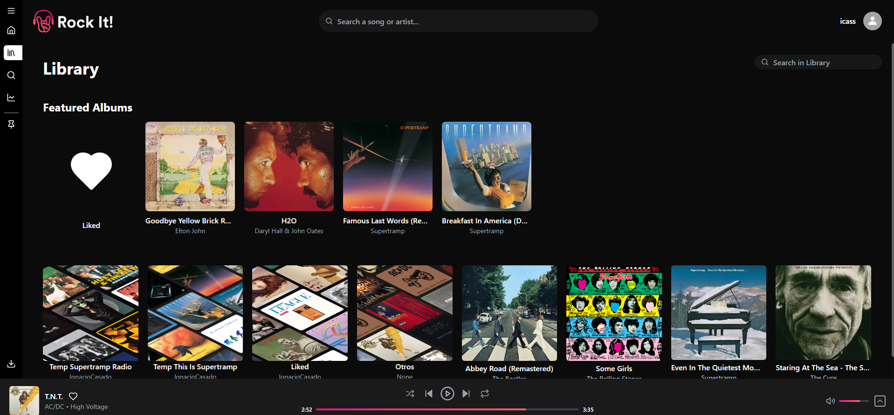
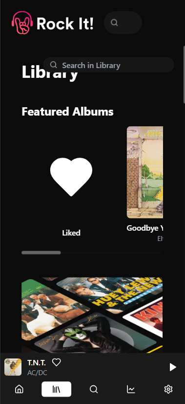
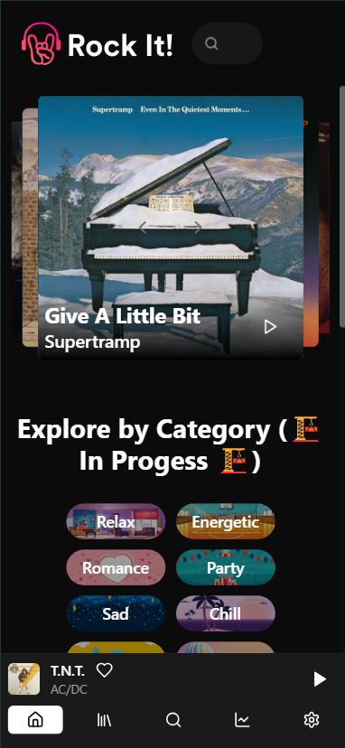

<div align="center">
  <a href="https://github.com/Icass1/rockit">
    
  </a>

# Your music. Your space. RockIt!

**A self-hosted home for your music — built for listening, collecting, and sharing.**

A personal library, a player that travels with you, and music worth discovering together.

[](https://github.com/Icass1/rockit/actions/workflows/pull-request-checks.yml)
[](LICENSE)
[](apps/web)
[](apps/mobile)
[](apps/backend)

[Get started](#local-development) · [Features](#made-for-your-music) · [Architecture](#under-the-hood) · [Documentation](#explore-the-documentation) · [Contribute](CONTRIBUTING.md)

**Self-hosted · Music library · Web / PWA / Mobile · Social listening · S3-compatible**

</div>

---

RockIt! brings your collection, playlists, discovery, and friends into one music
player that you host yourself. Use the web app, install it as a PWA, or develop
and build the native Expo app. PostgreSQL holds application data; S3-compatible
storage holds persistent media and artwork.

## Made for your music

| Capability                           | Experience                                                                                                                                                                                        |
| ------------------------------------ | ------------------------------------------------------------------------------------------------------------------------------------------------------------------------------------------------- |
| **A library you can explore**        | Organize songs, albums, and playlists. Search for individual tracks inside albums and playlists, then play just the song you wanted.                                                              |
| **Your collection, within reach**    | Anchor albums, artists, playlists, and personal RockIt! lists in navigation. Drag songs or albums into playlists you own.                                                                         |
| **A player that keeps up**           | Playback queues, shuffle, repeat, track transitions, and system media controls. Picture-in-Picture and the animated vinyl view are available on supported browsers.                               |
| **Lyrics that follow the recording** | Plain and synchronized lyrics, version-aware matching, and reviewed timing corrections. Availability and alignment depend on the source recording and lyrics metadata.                            |
| **Discovery with a fallback**        | Last.fm suggestions when configured, with local recommendations from RockIt! as a fallback. Artwork is resolved lazily and cached.                                                                |
| **Listen together**                  | Friends, music sharing, activity, and host-led listening sessions. Each participant streams through their own authenticated session.                                                              |
| **Bring sources together**           | Provider integrations for Spotify, YouTube, and YouTube Music, alongside uploaded music. Background download processing selects catalogue audio for songs and preserves separate video downloads. |
| **Choose your screen**               | A responsive web app and installable PWA, plus an Expo / React Native app with shared client and application logic.                                                                               |
| **Make it feel like yours**          | Account themes, translated interface vocabulary, and a shared visual system across the web experience.                                                                                            |

Provider availability depends on your configuration and the upstream service.
Native builds and browser-specific playback features have their own requirements;
see the linked guides before deploying or building for a device.

<details>
<summary><strong>A look at RockIt! — screenshots from an earlier interface</strong></summary>

These images are already part of the repository. They show an earlier interface,
not a freshly captured preview of the current branch.



<p align="center">
  
  
</p>

</details>

## Under the hood

[](https://www.typescriptlang.org/)
[](https://react.dev/)
[](https://tailwindcss.com/)
[](https://www.python.org/)
[](https://www.postgresql.org/)

| Layer                | Stack and responsibility                                                                                    |
| -------------------- | ----------------------------------------------------------------------------------------------------------- |
| **Web**              | Next.js 16 · React 19 · TypeScript · Tailwind CSS v4                                                        |
| **Mobile**           | Expo · React Native · TypeScript                                                                            |
| **API**              | FastAPI · Pydantic · async SQLAlchemy · asyncpg                                                             |
| **Data**             | PostgreSQL for application data; S3-compatible object storage, including Silo / MinIO, for persistent files |
| **Shared contracts** | Generated Zod DTOs, typed HTTP client, models, and shared managers                                          |
| **Tooling**          | pnpm workspace · Turborepo · uv · GitHub Actions                                                            |

The backend follows **controller → framework → access**. Provider-specific
behavior stays inside its integration; core coordinates generic capabilities.
The web uses server-side loaders, scoped Context, and narrow playback-state
subscriptions. Shared packages keep web and native clients on the same API
contracts.

## Local development

Run the following commands from the repository root unless stated otherwise.

### Prerequisites

- Node.js 24 and pnpm **11.0.8**, as pinned in `package.json`.
- Python **3.12** and uv.
- A running PostgreSQL instance with a development database and credentials.
- An S3-compatible service with credentials and a bucket available to the application.
- FFmpeg on `PATH` for media processing. Native Python dependencies may also require a compiler and PostgreSQL development headers.
- For native mobile development, the Android SDK or Xcode on macOS, as appropriate.

### Install and configure

```sh
git clone https://github.com/Icass1/rockit.git
cd rockit
pnpm install --frozen-lockfile
uv sync --project apps/backend --locked --dev
cp apps/backend/.env.example apps/backend/.env
cp apps/web/.env.example apps/web/.env.local
# Optional: configure the mobile app.
cp apps/mobile/.env.example apps/mobile/.env
```

Edit the copied files before starting the apps. Example credentials are placeholders;
the backend example also uses one-second session lifetimes. For a development
session, set e.g. `SESSION_DURATION=3600` and
`SESSION_DURATION_REMEMBER_ME=86400`. Generate a session-signing secret with:

```sh
python -c "import secrets; print(secrets.token_urlsafe(48))"
```

| File                  | Configuration                                                                                                                                                                                                                                                                                                      |
| --------------------- | ------------------------------------------------------------------------------------------------------------------------------------------------------------------------------------------------------------------------------------------------------------------------------------------------------------------ |
| `apps/backend/.env`   | Set `DB_*` for your development database, `S3_*` for object storage, and a random `SESSION_TOKEN_SECRET` of at least 32 characters. Set `CORS_URLS=http://localhost:3000`, session domains to `localhost`, and suitable session durations in seconds. Configure provider credentials for the integrations you use. |
| `apps/web/.env.local` | Set `NEXT_PUBLIC_BACKEND_URL=http://localhost:8000` and `NEXT_PUBLIC_S3_PUBLIC_ENDPOINT_URL` to the storage endpoint reachable by the browser.                                                                                                                                                                     |
| `apps/mobile/.env`    | Set `EXPO_PUBLIC_BACKEND_URL` to a backend address reachable by the device or emulator and `EXPO_PUBLIC_PLATFORM` for the target platform. A physical device cannot use your computer's `localhost`.                                                                                                               |

The backend accepts `ENV_FILE` to select an explicit configuration file; `ROCKIT_ENV_FILE` is also supported. Keep local environment files and credentials out of version control.

Media URLs point directly to the public S3 endpoint. Configure storage access and browser CORS for your deployment. Persistent media belongs in object storage; `TEMP_PATH` is temporary processing space.

### Start the applications

Run each application in a separate terminal:

```sh
pnpm dev:backend
```

```sh
pnpm dev:web
```

```sh
# Optional: start the Expo development server.
pnpm dev:mobile
```

The backend listens on port **8000** and the web app on port **3000** by default. Open [the web app](http://localhost:3000) or [the API documentation](http://localhost:8000/docs). Native mobile integrations may require a development build; see [the mobile guide](apps/mobile/AGENTS.md).

## Repository layout

```text
apps/
  backend/       FastAPI API, providers, CLI, and Python tests
  web/           Next.js web application
  mobile/        Expo mobile application
packages/
  shared/        HTTP client, generated DTOs, models, and shared managers
  config/        Shared frontend configuration
scripts/         Quality checks, builds, and release tooling
docs/            Technical references and feature documentation
```

## Verification

```sh
cp apps/backend/.env.test.example apps/backend/.env.test
pnpm check:backend
pnpm check:frontend
# Or run both gates:
pnpm check
```

The backend gate installs dependencies, regenerates DTOs, and runs tests, formatting, lint, and type checks. The frontend gate installs dependencies, formats source files, checks workspace types, and runs web lint. Review any generated or formatting changes afterward.

See [CONTRIBUTING.md](CONTRIBUTING.md) for focused checks and contribution conventions.

## Containers and deployment

Build the backend and web images from the repository root:

```sh
docker build -f apps/backend/Dockerfile -t rockit-backend .
# Replace these example URLs with your public API and storage endpoints.
docker build -f apps/web/Dockerfile -t rockit-web \
  --build-arg NEXT_PUBLIC_BACKEND_URL=https://api.music.example \
  --build-arg NEXT_PUBLIC_S3_PUBLIC_ENDPOINT_URL=https://files.music.example .
```

The checked-in `compose.yaml` is a deployment-specific starting point. It expects a root `.env.production`, an existing external PostgreSQL Docker network, and separately provisioned PostgreSQL and S3 storage. Review its network names, ports, and frontend build arguments, including the backend URL, before using it for your own host. Public frontend configuration is embedded at build time.

The Compose stack includes a YouTube proof-of-origin token provider. Backend volumes hold temporary files and logs; persistent media remains in S3.

## Explore the documentation

| Start here                                                                                                                                 | What you will find                                        |
| ------------------------------------------------------------------------------------------------------------------------------------------ | --------------------------------------------------------- |
| [Contributing](CONTRIBUTING.md)                                                                                                            | Development conventions, checks, and pull requests        |
| [Project board](docs/Kanban.md)                                                                                                            | Work planned and awaiting review                          |
| [Web architecture](docs/web-guide.md) · [Backend architecture](docs/backend-guide.md)                                                      | How the applications fit together                         |
| [Desktop and universal mobile architecture](docs/FRONTEND_PLATFORM_ARCHITECTURE.md)                                                        | Shared core, UI and platform boundaries                   |
| [Implemented frontend diagrams](docs/FRONTEND_IMPLEMENTATION.md)                                                                           | Shared components, mobile targets and concrete code paths |
| [Frontend verification](docs/FRONTEND_TESTING.md)                                                                                          | Fast contracts, browser checks and device acceptance      |
| [Library search](docs/LIBRARY_SONG_SEARCH.md) · [Drag and drop](docs/LIBRARY_DRAG_DROP.md) · [Navigation anchors](docs/NAVIGATION_PINS.md) | Finding and organizing your collection                    |
| [Lyrics](docs/LYRICS_MATCHING.md) · [Recording selection](docs/SONG_RECORDING_SELECTION.md)                                                | Matching the right words and the right recording          |
| [Recommendations](docs/RECOMMENDATIONS.md) · [Friends and listening sessions](docs/listen-together.md)                                     | Discovery and shared listening                            |
| [YouTube downloads](docs/YOUTUBE_DOWNLOADS.md) · [Mobile builds](docs/BUILDINGAPKIPA.md)                                                   | Provider setup and native build instructions              |
| [Web](apps/web/AGENTS.md) · [Backend](apps/backend/AGENTS.md) · [Mobile](apps/mobile/AGENTS.md)                                            | Current application-specific engineering rules            |

Some feature documents include implementation history, controlled test results,
and remaining acceptance checks. They are more precise than a blanket claim of
browser or device compatibility.

## Build it with us

Found a bug, have an idea, or want to improve the experience?
[Open an issue](https://github.com/Icass1/rockit/issues/new) or read the
[contribution guide](CONTRIBUTING.md). Useful contributions include reproducible
bug reports, translations, accessibility improvements, documentation, and code.

For playback issues, include your browser/device, playback mode, and steps to
reproduce. Remove credentials, cookies, and personal information from logs.

## Security

Please report suspected vulnerabilities privately. See [SECURITY.md](SECURITY.md)
for reporting instructions, scope, version policy, and responsible testing.

## Credits and license

Created by **[Ignacio Casado · Icass1](https://github.com/Icass1)** and
**[Nicolás Rebollo · Nicorebo-18](https://github.com/Nicorebo-18)**, with the
[RockIt! contributors](https://github.com/Icass1/rockit/graphs/contributors).

RockIt! is released under the **[MIT License](LICENSE)**. You may use, modify,
and redistribute the software, including commercially. Copies or substantial
portions of the software must retain the copyright and permission notice in
`LICENSE`, including in modified distributions. MIT does not require a visible
credit in an application's interface or publication of modified source code.

Third-party dependencies and media retain their own licenses and rights. The
software license does not grant rights to music, artwork, or external services.
