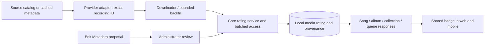

# Recording content ratings

RockIt! stores a recording's classification locally. Displaying the explicit badge
never needs a request to an external catalog. This is a metadata resolver, not an
audio/profanity classifier or a parental-control guarantee.

## Evidence and recording identity

| Stored value | Meaning | Automatic evidence |
| --- | --- | --- |
| `true` | Explicit | Positive structured evidence for the exact source track ID |
| `false` | Confirmed clean | Reserved for a reviewed decision or a provider with an unambiguous clean field |
| `null` | Unknown | Absent, ambiguous, unsupported, or temporarily unavailable evidence |

Spotify's `explicit: false` means **not explicit OR unknown** in its published
schema. It cannot establish confirmed-clean status. The YouTube Music adapter
accepts positive `isExplicit` on the exact album-track ID; an absent/false flag
stays unknown. It never substitutes an album-wide label, artist name, age
restriction, title keyword, lyrics word list, or another track's evidence.

Studio, live, remix and clean editions retain their own IDs and labels. No fuzzy
title or duration match transfers classifications between recordings. Providers
without structured evidence currently remain unknown until reviewed. In
particular, uploaded RockIt! files and Spotify Scrapper data without an exposed
rating do not get guessed labels. This limitation favors precision over coverage.

References checked on 2026-11-08:

- [Spotify track reference](https://developer.spotify.com/documentation/web-api/reference/get-track)
  and [public OpenAPI schema mirror](https://github.com/sonallux/spotify-web-api/blob/master/fixed-spotify-open-api.yml):
  the track object's `explicit` description includes the unknown case.
- [ytmusicapi album response documentation in source](https://github.com/sigma67/ytmusicapi/blob/main/ytmusicapi/mixins/browsing.py):
  per-track `isExplicit` is part of catalog album responses.

The policy is verified against these public definitions and deterministic source
fixtures. No live production-library classification accuracy percentage has been
measured, and missing flags must not be described as confirmed clean songs.

## Storage and boundaries

Migration 5 adds `is_explicit`, `explicit_source`, and `explicit_manual` to
`core.media`. New fields are independent of storage-object references. No audio,
artwork, S3 keys, or existing storage migrations are rewritten.



Core calls an optional generic provider capability. Interpretation of Spotify
and YouTube Music fields remains inside their providers. SQL stays in access.
Song DTOs expose nullable `explicit` and `explicitSource`. Generic response
assembly performs one batched local rating lookup across nested songs, including
duplicate queue occurrences. Provider response conversions reuse already loaded
media rows where available. Normal reads never invoke rating-source refresh.

Automatic updates include an atomic `explicit_manual = false` predicate. A
reviewed decision, including reviewed unknown, cannot be overwritten by a racing
backfill/download. Missing automatic evidence cannot clear a known rating.

## Edit Metadata and review

The desktop and mobile editors offer unknown, explicit and confirmed-clean
choices, translated through `Vocabulary.xlsx` in English, Spanish and French.
Leaving the choice untouched does not add a rating change to an unrelated edit.

The existing `METADATA` proposal contains an `explicit` value of `unknown`,
`explicit` or `clean`. The backend validates it before creating a request and
again before applying an accepted review. Acceptance persists a manual override
in the same request transaction; rejection changes no rating. Existing request
history records the reviewer and review comment. Other metadata fields retain
their existing behavior.

The authenticated `/content-rating/lookup` endpoint supports batches of up to 100
public song IDs. Admin-only `/content-rating/{public_id}` provides a direct
manual override; `/content-rating/backfill` processes a bounded local/cache-only
page. Neither route accepts internal database IDs or arbitrary catalog URLs.

## Existing downloaded songs

Backfill is explicit, bounded and resumable. It does not run inside a playback
request or automatically start a production library scan.

```sh
# At most 20 pages of 25 songs. Uses local/provider caches only.
uv run --project apps/backend python -m apps.backend backfill-content-ratings --rating-pages 20

# Resume from the nextAfter public-ID cursor printed for the last successful page.
uv run --project apps/backend python -m apps.backend backfill-content-ratings --rating-pages 20 --rating-after PUBLIC_ID

# Optional catalog refresh, using existing provider pacing, sessions and timeouts.
uv run --project apps/backend python -m apps.backend backfill-content-ratings --rating-pages 20 --refresh-rating-sources
```

The endpoint equivalent is an admin `POST /content-rating/backfill` with
`{"after":"","limit":25}`. `limit` is bounded to 1–100. Each page scans song
identities, skips reviewed songs, filters to downloaded songs, groups by provider
and writes evidence in batches. `processed` counts examined downloaded entries
submitted for update, **not** newly identified explicit songs. `hasMore` and
`nextAfter` describe the scan, including pages with no eligible downloads.

Pages commit separately in CLI mode. On a failed page, retry that page's input
cursor; rerunning a page is safe. A new full scan starts with an empty cursor and
also includes newly inserted IDs that sort before a previous cursor. Unknown
results remain eligible for future evidence. Remote refresh can take longer
than a cache-only page and is intentionally opt-in.

No production backfill has been executed as part of this PR. Deploying the
migration and deliberately running the backfill are operational follow-ups.

## Redownload refresh

A completed download event refreshes metadata only for identities already in the
queue. The shared manager patches sorted/random queues, loaded pages and the
selected occurrence, preserving queue IDs and list membership. It does not call
`setMedia`, acquire a new playback owner or restart the current audio. Wrong IDs,
non-playable results, failed responses, superseded requests and stopped sessions
cannot replace current metadata. Collection-tree refresh has equivalent lifecycle
and request-order guards.

Generic media lookup also returns `NOT_FOUND` for a provider's empty successful
list, instead of raising an index error. Controlled mixed-provider queue tests
reproduce stale metadata and prove refresh without a second player load; they
do not prove every possible cause of the reported production playlist crash.

## Verification

Focused backend tests cover conservative source interpretation, version identity,
SQL manual-override guards, batched nested enrichment, bounded local backfill,
review acceptance/rejection, source outages and empty provider replies. Frontend
contracts validate positive and unknown ratings; renderer tests cover accessible
badges on DOM and native Text. Queue tests cover duplicate occurrences, late
responses, concurrent refreshes, wrong identities and non-playable responses.

These fast checks use isolated fixtures and do not download media, contact S3,
scan the production library, or claim physical-device acceptance.
