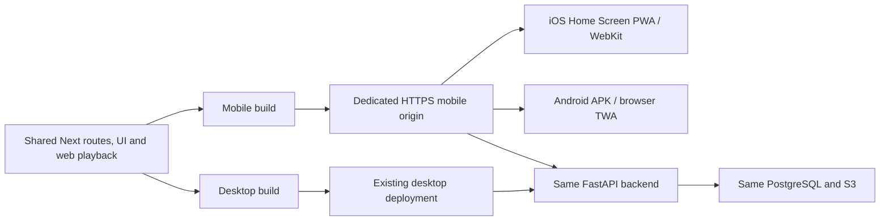

# Mobile platform decision for RockIt!

Status: **implemented pilot, not a production cutover**. Reviewed against the
repository and the sources below on 2026-11-07. No universal iOS/Android support,
native-equivalent background execution or permanent browser downloads is claimed.

## Decision

Use the existing Next.js **mobile web UI** as the shared candidate for iPhone Home
Screen PWA and Android **Trusted Web Activity (TWA)** distribution. Build desktop
and mobile entries separately from the same source, routes, styles and providers.
Keep the existing Expo app as rollback until real-device acceptance passes.

The current mobile web experience is more developed than the native UI. Rewriting
it as React Native would replace DOM/CSS/Next components with native components;
Expo Web does not make that conversion automatic. Conversely, shipping a Next.js
site inside an APK does not give it Expo's native audio/filesystem guarantees.

| Approach                           | Reuse current mobile web UI                                                         | Android APK                | Playback/storage tradeoff                                                                                        |
| ---------------------------------- | ----------------------------------------------------------------------------------- | -------------------------- | ---------------------------------------------------------------------------------------------------------------- |
| Native Expo / React Native         | Shared logic, not Next DOM UI                                                       | Existing EAS/Gradle path   | Native audio sessions and files; requires continued native UI work                                               |
| Mobile Next PWA + TWA              | Same web UI on iOS and Android                                                      | Browser-hosted TWA wrapper | Browser Media Session and origin storage; real-device background gates required                                  |
| Capacitor / embedded WebView       | Reuses DOM UI; Next server still needs hosting or a static/client-only architecture | Native wrapper             | Media Session support differs, notably Android WebView; robust background audio needs native plugins/bridge work |
| Two independent mobile UI rewrites | Little direct reuse                                                                 | Depends on chosen runtime  | Highest maintenance cost; does not resolve browser policy by itself                                              |

**Fallback decision:** if TWA fails the screen-lock/queue/offline gates, keep Expo
as Android production. Do not silently reduce playback reliability to claim one
platform. A future native media bridge is a separate implementation, not something
provided by this PR.

## What was actually wrong in the layout

AppClientLayout imported desktop Footer, Header, Navigation, PlayerUI and the
mobile player/navigation together. CSS `hidden` prevented painting but did not
prevent mounting all subtrees or running their effects. PlayerUI itself returned
null at small widths, but its module was still statically imported.

The new layout owns only common providers, the video root, shared content and the
share dialog. Its shell entry is selected **at build time**:

- `ROCKIT_WEB_TARGET=mobile`: MobileShell/MobileChrome, always mobile controls,
  even on a wide phone/tablet or landscape viewport. No desktop chrome imports.
- `ROCKIT_WEB_TARGET=desktop`: DesktopShell/DesktopChrome. No mobile player entry.
- Unset / `responsive`: compatibility deployment; SSR keeps the page content and
  client matchMedia loads/mounts exactly one chrome. Resizing can load the other
  later, so only a dedicated build guarantees its absence from the build graph.

This isolates application chrome, not every feature module. Routes and their
responsive content remain shared. It does not prove that all latency is caused
by chrome or remove network, image, provider, or audio decoding costs.



## Storage: no seven-day timer per song

Next.js does not choose browser quotas. React Native uses native adapters; React
Native Web in a browser uses browser rules. Their storage is not equivalent.

| Runtime                     | Current RockIt! implementation                                                                                                          | Retention                                                                                             |
| --------------------------- | --------------------------------------------------------------------------------------------------------------------------------------- | ----------------------------------------------------------------------------------------------------- |
| Web / iOS PWA / Android TWA | Audio and cover **Blobs in IndexedDB**; metadata/session snapshots in IndexedDB and Cache Storage; service worker for app/API resources | Per-origin browser quota and eviction; user clearing data and uninstall/reinstall remain relevant     |
| Native Expo app             | MediaCacheManager uses `expo-file-system` **Paths.cache**; native player consumes file URIs                                             | Native cache can also be removed by the OS under storage pressure; not the durable document directory |
| Backend                     | Persistent objects in S3; accounts/library/history in PostgreSQL                                                                        | Independent of client cache; this change does not migrate or rename any objects                       |

Safari's seven-day rule concerns **script-writable site storage after days of
Safari use without interaction**, not time since each audio file was read. The
Chrome/web.dev article linked below explicitly distinguishes Home Screen PWAs
from that ordinary Safari-site policy. Do not treat opening any file once a week
as a permanent-retention strategy. Installed apps can still lose local data via
other paths; exact behavior needs checking on the target iOS version.

Modern WebKit storage policy changed again in iOS 17/macOS 14. MDN documents
per-origin budgets around 60% of disk for browser/Home Screen apps and lower
budgets for embedded WebViews; these are not a promise of usable free space.
`navigator.storage.estimate()` is an estimate, and `persist()` is a request that
can be denied, not a reservation or a backup. RockIt! already guards and requests
persistence during initialization and maps IndexedDB quota failure to STORAGE_FULL.
Its explicit audio records have no seven-day TTL. Some service-worker metadata
caches do have a seven-day expiration configured by RockIt!, which is separate.

Cache API, IndexedDB and OPFS share browser-origin storage constraints; switching
Blobs to OPFS does not bypass eviction. OPFS is not required by this pilot. Cache
Storage can cache application/network responses, while browser audio range
requests remain network-only in the existing worker. Offline playback resolves
saved IndexedDB Blobs through object URLs, not through that network cache rule.

A production offline contract must tolerate quota denial, incomplete downloads,
data eviction, private browsing and account changes. Do not delete other downloads
automatically to make room. Existing explicit-download and auth cleanup behavior is
retained, not replaced with a new persistence layer in this pilot.

## Playback and capability differences

- iOS PWA executes in WebKit. Android TWA uses a supporting browser, commonly
  Chrome/Chromium, not the Expo runtime and not a WebView. The installed APK does
  not itself implement a native media foreground service or native audio queue.
- Existing web audio/iOS transition and Media Session logic is reused. Sharing UI
  does not remove platform-specific behavior or make JS timers reliable in the
  background. Do not use service workers as persistent audio players.
- Expo's audio documentation describes Android foreground media service and lock
  screen setup for sustained native background playback. Those guarantees do not
  transfer to TWA by copying the UI.
- MDN compatibility data reports Media Session in Safari 15 and Chrome Android 57;
  individual actions still differ and Android WebView is marked unsupported.
  API presence alone does not prove long background track progression.
- Web Audio transitions need feature detection and fallback; iOS audio activation,
  OS interruptions and Bluetooth behavior remain separate acceptance cases.
- Document Picture-in-Picture is not a universal mobile API. Desktop vinyl PiP is
  excluded with desktop chrome; a mobile layout does not promise that feature.
- Downloads can be interrupted when the browser suspends the app. Large offline
  transfers should be completed in the foreground; background-fetch support is
  not assumed.

The existing Tailwind v4/modern Next app already has modern browser requirements.
Proposed first physical targets: current Safari/Home Screen iOS 17+ and current
Chrome on Android 10+. These are pilot targets, not a claim that every OS/browser
version in those ranges has been tested. Feature-detect storage and media APIs.

## Build, run and verify isolation

From the repository root, after normal workspace dependency installation:

```sh
pnpm dev:web:mobile          # port 3100
pnpm dev:web:desktop         # port 3000
pnpm build:web:mobile       # apps/web/.next-mobile
pnpm build:web:desktop      # apps/web/.next-desktop
pnpm start:web:mobile
pnpm start:web:desktop
```

Default `pnpm dev:web` / `pnpm build:web` retains the responsive origin. Independent
output directories avoid overwriting another target's assets. Use separate
processes/containers, not per-request user-agent selection or viewport redirects.
Do not change the target between building and starting a given artifact.

For a production **diagnostic build**, enable browser source maps and inspect the
actual compiled client graph:

```sh
ROCKIT_ANALYZE_CLIENT=1 pnpm build:web:mobile
node scripts/check-web-client-build.mjs mobile
ROCKIT_ANALYZE_CLIENT=1 pnpm build:web:desktop
node scripts/check-web-client-build.mjs desktop
```

Source maps are disabled by default; do not publish diagnostic builds inadvertently.
This checks shell module presence/absence, not just CSS or viewport screenshots.
CI regressions also cover build-target selection, shell dependency graphs, and
Android origin/signing-association validation.

## Dedicated subdomain and Android packaging

The concrete hostname is deployment configuration. `mobile.music.example` below
is an example, not a newly registered or deployed site.

1. Build/deploy the mobile target using `compose.mobile.yaml` and `.env.mobile.example`.
   Serve it behind HTTPS at a dedicated hostname. Existing desktop Compose remains
   unchanged. The web Dockerfile accepts ROCKIT_WEB_TARGET and public URL build args.
2. Keep NEXT_PUBLIC_BACKEND_URL pointing to the existing API and configure the
   server-only BACKEND_INTERNAL_URL for container reachability. NEXT_PUBLIC_SITE_URL
   must match the new mobile origin and is embedded during build.
3. Add the new exact origin to backend CORS and S3 CORS where required. Preserve
   authenticated credentialed requests. For existing cookie-based SSR, the frontend
   must receive the session cookie too: configure the existing web cookie domain
   appropriately for trusted same-site subdomains, or design a same-origin auth
   proxy separately. Do not broaden cookies onto untrusted subdomains. This PR does
   not change production cookie/CORS settings or create a second user database.
4. iOS users visit that mobile origin and add it to their Home Screen. A web install
   needs no Apple Developer Program subscription or App Store review. This is not
   an iOS native package distribution route.
5. Follow [the Android PWA wrapper guide](../apps/android-pwa/README.md). It creates
   validated Bubblewrap configuration for an explicit pilot package/signing identity.
   The public `/.well-known/assetlinks.json` route associates only configured package
   IDs and SHA-256 signing certificates. No auth/session data is exposed there.
6. Verify the installed APK against the deployed HTTPS origin and its signing
   fingerprint. A mismatch can leave a Custom Tab instead of verified full-screen
   TWA. Do not confuse an APK that builds with successful domain verification.

A subdomain alone does not reduce JS. It must serve the **mobile build**. IndexedDB,
Cache Storage, service workers and installed-web-app identity are origin scoped.
The old and new origins do not share offline audio automatically, even if account
cookies share a parent domain. Existing iOS Home Screen installs keep their old
origin; changing an address does not update them into a different installed app.

## Cutover and rollback gates

Use a separate Android pilot ID/signing key. Keep the native APK and old PWA usable.
No forced redirect, source deletion, EAS replacement, credential change or server
storage migration is included. Account/library data stays on the same backend;
local downloads need an explicit re-download/migration plan for the new origin.

Before promoting the candidate:

- On real iPhone PWA and Android TWA: cold launch, login/logout/account changes,
  queue/library/search/playlists, lyrics, recommendations, sharing and settings.
- Play through multiple track boundaries under screen lock, with transitions on
  and off; verify audible continuity, Media Session state and next/previous controls.
- Check interruption/resume, Bluetooth, battery saver, background/foreground,
  rotation, keyboard, short landscape, safe areas and reduced motion.
- Download a playlist, restart offline, seek and advance tracks; simulate quota
  denial and missing blobs without losing unrelated downloads or leaking accounts.
- Test service-worker update with playback active and a cold offline launch after
  app/browser restart. Revisit installed iPhone PWA retention over actual elapsed
  days; desktop emulation cannot establish iOS retention policy.
- Verify TWA association, signing, upgrade behavior, deep links, browser fallback
  and browser availability. A certificate placeholder or unconfigured origin is
  not a release candidate.

If background or offline behavior fails, roll back the pilot distribution to Expo
and keep the dedicated mobile PWA improvement. Do not mark the migration complete
on the basis of TypeScript, a Chromium screenshot or an unsigned APK.

## Sources and research provenance

Retrieved documentation via the publishers' GitHub repositories because direct
requests to their documentation hosts were blocked by the environment's proxy.
No bypass was used. See the PR for build/browser verification results.

- [MDN: storage quotas and eviction](https://github.com/mdn/content/blob/main/files/en-us/web/api/storage_api/storage_quotas_and_eviction_criteria/index.md): current per-origin behavior, Safari 17 quotas, best-effort/persistent data and quota failure.
- [Chrome/web.dev: Storage for the web](https://github.com/GoogleChrome/web.dev/blob/main/src/site/content/en/blog/storage-for-the-web/index.md): older article, used specifically for its Home Screen PWA/ITP distinction; its historical quota numbers are superseded by current MDN/WebKit documentation.
- [WebKit: full third-party cookie blocking and more](https://webkit.org/blog/10218/full-third-party-cookie-blocking-and-more/) and [storage policy updates](https://webkit.org/blog/14403/updates-to-storage-policy/): primary policy links referenced by those retrieved documents; direct retrieval was blocked.
- [MDN compatibility: StorageManager](https://github.com/mdn/browser-compat-data/blob/main/api/StorageManager.json): support differs by method (notably estimate versus persist).
- [MDN compatibility: MediaSession](https://github.com/mdn/browser-compat-data/blob/main/api/MediaSession.json): browser and WebView distinctions.
- [Expo Audio](https://github.com/expo/expo/blob/main/docs/pages/versions/unversioned/sdk/audio.mdx): native background audio, foreground service and lock-screen requirements; match implementation guidance to the installed Expo version.
- [Android Browser Helper](https://github.com/GoogleChrome/android-browser-helper): TWA browser integration and verification behavior.
- [Bubblewrap CLI](https://github.com/GoogleChromeLabs/bubblewrap/tree/main/packages/cli): APK/AAB generation, fingerprints and signing workflow. Version 1.27.0 was also checked on the npm registry.

## Verification recorded for this pilot

- Production builds of mobile, desktop and compatibility entries completed with
  the installed Next.js 16.2.0 toolchain. Mobile/desktop diagnostic builds were
  inspected using their actual client source maps: mobile includes MobileChrome
  and excludes DesktopChrome, Footer, Header, Navigation, PlayerUI and desktop
  keyboard entry modules; desktop excludes MobileChrome and MobilePlayer.
- A directed Chromium check ran the production servers with a local controlled
  backend and service workers enabled. Mobile stayed mobile at 390×844, 844×390
  and 1440×900; desktop stayed desktop at 1440×900. Each had one shell, one scroll
  root and one shared video root, with no page exceptions in those checks.
- The compatibility responsive origin also passed phone/landscape/wide checks;
  resizing a phone viewport to desktop preserved the same scroll/content root
  and switched to one desktop chrome without page exceptions.
- That fixed Library fixture transferred 471,900 bytes of script for the mobile
  entry and 488,591 for desktop. This compares two new profiles, not the old app,
  and is not a latency benchmark or a promise of a large payload reduction.
- Generated Android configuration passed the published @bubblewrap/core 1.27.0
  manifest validator and produced a real Android Gradle project. Generation used
  the repository logo through a loopback fixture and skipped remote web-manifest
  fetch only for that fixture. No APK/AAB was compiled, signed or installed, and
  no public domain/certificate association was verified.
- Evidence and local harnesses are outside Git in
  /workspace/artifacts/mobile-platform. Unit regressions are provided for CI;
  local test suites were not run. No production DNS, cookie/CORS, storage,
  signing identities, or app-store settings were changed.
