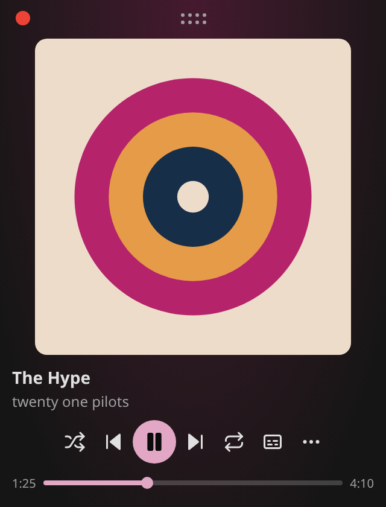
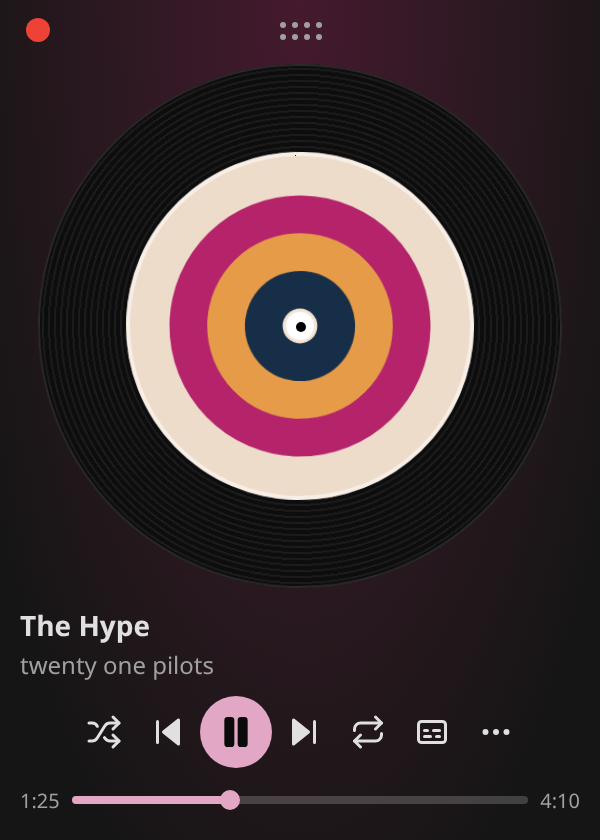
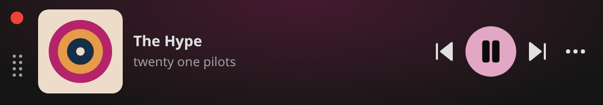
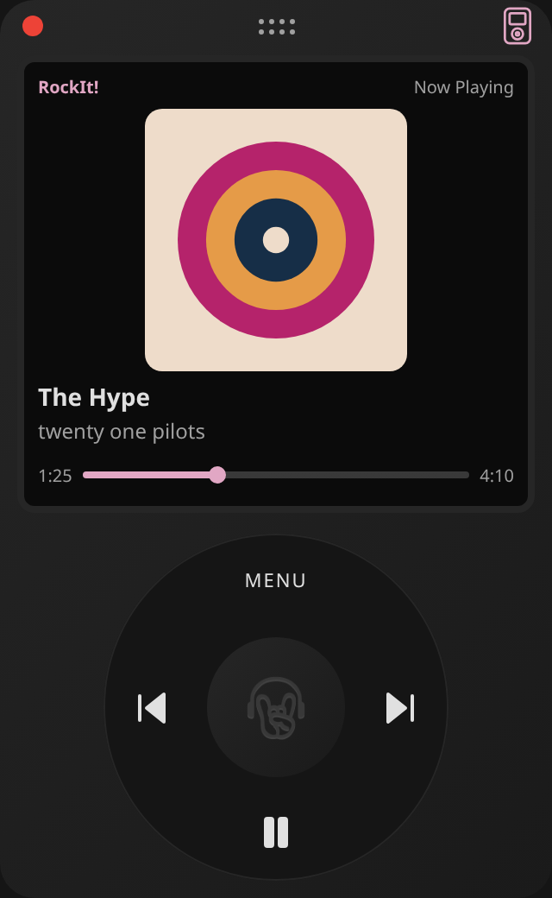
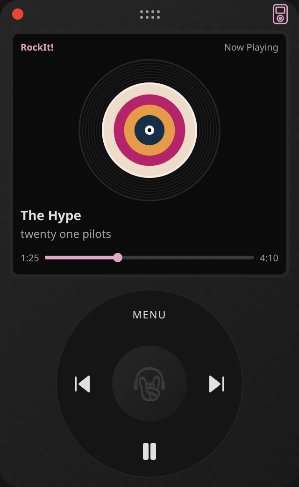
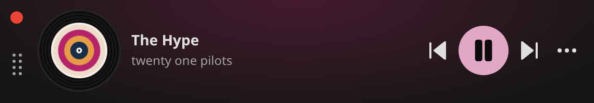

# Player follow-ups on the universal frontend

PR191 is stacked on PR189. Merge the frontend migration first, then retarget this
branch to develop. The parent implementation is kept intact.

## Behavior

- PiP uses one continuous background, integrated close/movement controls, and
  artwork/vinyl click-to-toggle playback. Vertical, compact horizontal and narrow
  layouts retain their controls. Even a 64-pixel-tall wide window stays horizontal.
- Browser Media Session never installs relative-seek handlers. Previous/next track
  and absolute seek remain available; the shared iOS detector also recognizes iPads
  using a desktop user agent. Native Android handlers are unaffected.
- Album redownload resolves all collection pages before deleting anything, deduplicates
  tracks, then checks each deletion and queue request. It stops on failures or account
  replacement. Existing backend admin authorization remains authoritative. Already
  queued tracks are not rolled back if a later request fails.
- Individual album/artist-page collaborator credits accept string and object metadata.
  Mobile cards display every supplied artist, and desktop artist rows preserve all
  names with a complete title. Missing historic credits are not invented or split
  heuristically from band names.
- PiP strings are sourced from Vocabulary.xlsx in English, Spanish and French;
  colors use semantic theme variables. No provider-specific rules were added to core.

## Captures

These are the real React PiP components rendered in local Chromium with synthetic
artwork and mock playback state, not production song artwork or an installed PWA.

| Vertical                                                  | Vinyl                                               |
| --------------------------------------------------------- | --------------------------------------------------- |
|  |  |

[Narrow 180×560 capture](images/player-followups/pip-narrow.png).

## Verification and limits

The fast frontend gate passed 301 tests (29 Vitest, 8 native Jest, 264 desktop).
The focused provider credit suite passed 11 tests in 1.44 seconds. Workspace types,
formatting and web/mobile lint passed; the full required CI is green at 72dbfc65.
Artwork/vinyl pause and resume were exercised in five Chromium viewports:
320×420, 570×100, 300×420, 760×64 and 180×560.

Actual iPhone system-control presentation still needs device acceptance. Browsers
own native window chrome and can restrict auxiliary-window movement; the custom
handle cannot override that policy. Local captures validate the content UI and
mock playback transitions, not native window positioning or real background audio.

## RockIt! retro mode and spindle correction

A device-shaped header button appears in portrait PiP windows at least 220 pixels
wide and 380 pixels high. It toggles the optional RockIt! retro skin: artwork,
metadata/progress and a circular set of real queue/playback controls. MENU opens
the existing PiP controls, including lyrics and artwork mode; the same header button
returns to the normal player. Resizing to landscape temporarily shows the standard
layout and retains the chosen retro preference for a return to portrait.

The skin uses semantic theme values and workbook vocabulary in en/es/fr. It does
not instantiate another player or claim iPod firmware/touch-wheel behavior.

The vinyl spindle dot now scales with its housing and uses grid centering instead
of a fixed-size absolutely positioned dot, which could overflow its tiny housing.
Local Chromium measured center deltas below 0.02 CSS pixels, including the horizontal
mini vinyl. The same existing vinyl artwork mode works in horizontal mini layouts.

Directed checks passed: retro previous/next, wheel pause/resume, exit to standard
mode and geometric spindle centering; desktop TypeScript and changed-module lint
also passed. These are fixture/component checks, not physical-device acceptance.

The wheel center uses the existing RockIt! logo at 54% of the center button.
CSS brightness/inversion flatten it to a uniform dark gray, with a subtle semantic
highlight shadow for an engraved finish and no retained pink tint. It remains
decorative inside the existing labelled play/pause button.

## Calm lyric emphasis without reflow

Player UI and PiP reserve each line at its maximum emphasized size before rendering.
Inactive text is visually scaled down; active text grows to 125% of its normal
appearance over 650ms. Font metrics, weight, available width and layout height do
not change with activation, so words retain their exact line breaks. Panels constrain
horizontal overflow, including long unbroken words, and do not intrude into artwork.

Both views use the same 900ms auto-scroll hook with a frame clock and cancellation
owned by their document window. Switching lines/unmounting cancels only that view;
resize recenters within the actual scroll container. Reduced-motion users receive
immediate emphasis/centering. Durations and scale are shared design tokens.

Directed Chromium checks on real lyric components preserved all ten wrapped rows
in the Player UI sample and eight in PiP, before and after activation. A 200ms sample
confirmed intermediate scale (about 0.833), rather than an instant change; line layout
heights stayed fixed and active text remained inside its panel. Two deterministic
component tests verify independent cancellation and reduced-motion centering (33ms
of test execution locally). Song/lyric timestamps and reviewed offsets are unchanged.

## PiP efficiency review

The mounted PiP shares the existing audio engine; the retro skin replaces the normal
presentation instead of mounting a second hidden player. Lyric retrieval is gated
by the existing enabled flag (no fetch while lyrics are closed). Theme/resize
observers, store listeners and lyric scrolling have cleanup; the window's pagehide
removes its React portal. Vinyl rotation still uses its document's animation clock
and cleans up on unmount. This is not a claim of zero idle animation-frame cost.

This review removed two unnecessary hot paths:

- Artwork no longer subscribes to playback time. Only the mounted video mirror
  subscribes when it needs synchronization; it remains muted.
- Lyric views subscribe to their active line index instead of rendering the entire
  list on every time sample. Reviewed offsets, duplicate timestamps and backward
  seeking retain their behavior. Player UI reuses that same narrow subscription.
- Compact PiP mounts the current-line view instead of keeping a hidden full list
  and its scroll observer. Full layouts mount only the full lyric view.
- Resize notifications with unchanged dimensions retain the current state object;
  lyric scroll avoids scheduling an animation when already centered.

A local Chromium fixture instrumented the real React components. Each scenario
applied 60 clock changes within the same lyric line, once per animation frame:

| Mode                | Artwork renders before → after | Lyric renders before → after |
| ------------------- | ------------------------------ | ---------------------------- |
| Cover + full lyrics | 60 → 0                         | 120 → 0                      |
| Vinyl + full lyrics | 60 → 0                         | 120 → 0                      |
| Retro + lyrics      | 60 → 0                         | 60 → 0                       |

The progress/time display still updates. These are component render counts under
controlled inputs, not production CPU, memory, battery or FPS benchmarks. Actual
video decoding, vinyl animation and browser drawing remain real costs. Low-end
hardware, minimized Vivaldi and long-running physical-device sessions are not
established by these measurements.

A deterministic component regression checks that 60 clock samples preserve the
render count while line changes, duplicate timestamps, reviewed offsets, backward
seeks and unmount cleanup remain correct. The scoped scroll/reduced-motion tests
also pass; three focused tests took 107ms of test execution locally.
