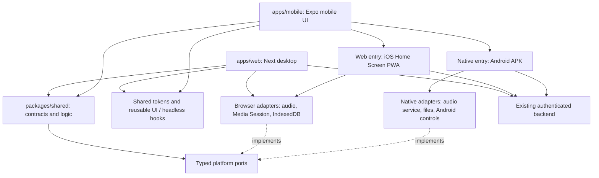

> **Historical reference — not current instructions.** See the [documentation index](../README.md) and [engineering instructions](../../AGENTS.md). Paths to retired files are retained as text.

# Frontend architecture: desktop web and universal mobile

Status: **implemented in PR #189; installed-device acceptance and rollout pending**. Reviewed on 2026-11-08
against `develop` at `62958ed7bec53bf4843c8ac7b70946b28c36e0f1` and the publisher
documentation listed below. This document supersedes the Android TWA recommendation
in the earlier [PR #188 pilot](https://github.com/Icass1/rockit/pull/188). That pilot
demonstrates web shell isolation, not the architecture or native capabilities below.

For the resulting code, concrete consumers and diagrams, see
[implemented frontend architecture](../frontend/architecture.md). The baseline and
alternative comparisons below preserve the reasoning behind the migration.

## Decision

Keep **Next.js / React DOM for desktop**. Evolve the existing **Expo application
into the mobile application**, with **React Native on Android** and **React Native
Web for the iOS Home Screen PWA**. Keep portable frontend logic in the existing
`packages/shared`, introduce shared design tokens and reusable UI deliberately,
and select platform adapters at the application entry point.

This meets the requirement for one maintained mobile product with real Android
integrations, without requiring a native iOS binary or an Apple Developer Program
subscription for the PWA. The iOS output is still a website running under browser
rules. Expo does not grant that output native iOS APIs.

There is an initial migration cost: the current mobile PWA uses DOM/CSS components.
React Native Web renders native-style components into DOM; it does not translate
arbitrary existing DOM components into native views. Preserve the current mobile
experience as the behavioral and visual reference, rather than shipping the older
native interface as the finished replacement.

Do not replace the maintained PWA or the Android package until an end-to-end
mobile slice and real-device playback/offline acceptance pass. Implementation and verification are tracked in
[the progress record](frontend-migration-progress.md); production activation remains
subject to these gates. Browser/component checks do not establish full installed-device
parity.

## Requirements that determine this choice

- Independent desktop and mobile entry points, deployments and dependency graphs.
  A desktop application must not initialize hidden mobile trees or mobile effects.
- One mobile UI for Android native and the iOS PWA, with small platform-specific
  presentations and adapters where behavior differs.
- Preserve native Android audio sessions, files, media controls and integration
  opportunities, rather than reducing Android to a browser-hosted APK.
- Share domain behavior, API contracts, vocabulary, state transitions and visual
  identity with desktop. Share actual UI where its renderer dependencies allow it.
- Retain the backend, authentication model, provider boundaries and S3 objects.
  Frontend separation does not require a database or storage migration.
- Preserve reliable playback, queue progression, lyrics timing and accessibility.
  Fewer source files is not a useful outcome if playback becomes less reliable.

## Baseline evidence before implementation

The following observations and source inventory describe the reviewed develop
baseline. The migration replaces its hidden mobile shell and guarded platform APIs;
see the progress record for the resulting implementation.

| Evidence in the reviewed commit                                                                                                                                                                                                                                                  | Implication                                                                                                                                                                      |
| -------------------------------------------------------------------------------------------------------------------------------------------------------------------------------------------------------------------------------------------------------------------------------- | -------------------------------------------------------------------------------------------------------------------------------------------------------------------------------- |
| [`apps/web`](../../apps/web/package.json) uses Next.js 16 / React 19; [`apps/mobile`](../../apps/mobile/package.json) already declares Expo, React Native, React Native Web and React DOM                                                                                              | The needed renderer families are already represented. Dependency presence alone does not prove that every mobile integration supports web.                                       |
| [`AppClientLayout`](../../apps/web/components/Layout/AppClientLayout.tsx) imports desktop chrome and a dynamically loaded mobile player, with viewport-based visibility                                                                                                             | Some UI is hidden rather than separated at the application boundary. Dynamic loading of one module does not establish isolation of the complete application.                     |
| [`BaseMediaPlayerManager`](../../packages/shared/src/managers/baseMediaPlayerManager.ts), [`BaseQueueManager`](../../packages/shared/src/managers/baseQueueManager.ts) and [`BaseUserManager`](../../packages/shared/src/managers/baseUserManager.ts) are shared                          | Queue/playback orchestration and preferences do not need a second independent implementation.                                                                                    |
| The web [`usePlayer`](../../apps/web/components/MobilePlayer/hooks/usePlayer.ts) presents the existing managers through the mobile player interface                                                                                                                                 | There is already a useful separation between state/actions and presentation. It is not proof that the DOM and native components are interchangeable.                             |
| [`PlaybackProvider`](../../apps/web/components/providers/PlaybackProvider.tsx) owns a playback lifecycle; [`rockitRef`](../../packages/shared/src/rockit/rockitRef.ts) retains the compatibility registry                                                                              | Continue toward scoped service injection, preserving existing owners. Do not add a second queue or another global player during migration.                                       |
| Web [`db.ts`](../../apps/web/lib/offline/db.ts) stores song/cover Blobs in IndexedDB                                                                                                                                                                                                | This browser implementation can be extracted behind an offline-media interface and reused by desktop and the mobile PWA.                                                         |
| Native [`mediaStorage`](../../apps/mobile/lib/storage/mediaStorage.native.ts) uses `Paths.document`; [`MediaCacheManager`](../../apps/mobile/lib/audio/MediaCacheManager.native.ts) uses `Paths.cache`                                                                                 | User downloads and disposable playback cache already have distinct locations. Moving Android entirely to web would change that retention model.                                  |
| Native [`api.ts`](../../apps/mobile/lib/api.native.ts) and [`http.ts`](../../apps/mobile/lib/http.native.ts) use SecureStore, file-backed metadata and native cookie handling                                                                                                          | They cannot simply become the PWA's HTTP/session implementation. Browser cookies and storage need their own adapter.                                                             |
| Mobile [`_layout.tsx`](../../apps/mobile/app/_layout.tsx) initializes native media storage even on the web path                                                                                                                                                                     | Enabling `expo start --web` alone is insufficient. Platform composition must separate native imports, initialization and browser services.                                       |
| Shared player synchronization contains guarded `document.visibilitychange` handling; shared configuration includes Next/Expo environment names and `packages/shared/package.json` declares Next                                                                                  | Existing shared code is a starting point, not yet a strictly framework-independent core. Lifecycle/configuration must move behind injected ports before enforcing that boundary. |
| The native [`lockScreenManager`](../../apps/mobile/lib/managers/lockScreenManager.native.ts), [`AudioIntegration`](../../apps/mobile/lib/audio/AudioIntegration.native.ts) and [`NativeMediaBridge`](../../apps/mobile/lib/audio/NativeMediaBridge.native.ts) contain Android integration | Preserve and audit those integrations. They do not become available inside an iOS PWA.                                                                                           |

A source inventory of the reviewed commit found:

| Directory                                         | TS/TSX files | TSX files | Files importing Next | Files with sampled DOM tags |
| ------------------------------------------------- | -----------: | --------: | -------------------: | --------------------------: |
| `apps/web/components`                             |          267 |       232 |                   73 |                         181 |
| `apps/web/components/MobilePlayer` (subset above) |           17 |        10 |                    0 |                          10 |
| `apps/mobile/components`                          |           92 |        81 |                    0 |                           0 |
| `packages/shared/src`                             |          320 |         0 |                    0 |                           0 |

The inventory counts `.ts`/`.tsx` files, import statements naming `next`/`next/*`,
and opening tags in `div, span, button, input, img, audio, video, canvas, section,
p, a`. It is a migration indicator, not a percentage of shareable code, a complete
browser-API audit or a performance benchmark. Many of the shared files are DTOs.
The mobile player is DOM-dependent even without importing Next directly.

## Alternatives considered

| Architecture                                       | Existing mobile DOM UI                                                   | Android integration                                                                                                          | Maintenance and migration                                                                               | Assessment for RockIt!                                                                                                                                                                              |
| -------------------------------------------------- | ------------------------------------------------------------------------ | ---------------------------------------------------------------------------------------------------------------------------- | ------------------------------------------------------------------------------------------------------- | --------------------------------------------------------------------------------------------------------------------------------------------------------------------------------------------------- |
| **Expo + React Native Web**                        | Adapt presentation to universal components once; reuse headless behavior | Existing native player, filesystem and bridges remain available                                                              | One mobile UI with platform adapters; desktop can reuse logic, tokens and suitable universal components | **Recommended** for the stated native Android requirement and the existing Expo investment.                                                                                                         |
| **Dedicated React DOM mobile + Capacitor Android** | Greatest direct reuse after removing Next server/router dependencies     | Native plugins can provide files, haptics and notifications; background audio needs a real native service/player integration | One DOM mobile UI; replace Expo integrations with Capacitor equivalents or custom plugins               | Credible alternative if minimizing the initial UI migration matters more than retaining the existing native stack. It is not a bad architecture, but its audio migration cost must be demonstrated. |
| **Expo DOM components + native adapters**          | Framework-neutral React DOM components can run in an embedded WebView    | Native actions can call Expo/native functionality across an asynchronous bridge                                              | Useful incremental bridge; separate JS runtimes, serialized state and navigation constraints            | Use selectively if needed for migration. Avoid one WebView per song/card and avoid making playback depend on continuous bridge traffic.                                                             |
| **Next mobile PWA + Android TWA**                  | Direct reuse of the web UI                                               | Browser-hosted APIs; a TWA alone does not supply Expo filesystem or a native audio service                                   | Lowest UI migration cost, but changes the Android capability/retention model                            | Does not satisfy the clarified native Android requirement. Keep #188's shell-isolation evidence separate from this decision.                                                                        |
| **Independent Next mobile and native mobile UIs**  | Preserves the current PWA                                                | Preserves Android native capabilities                                                                                        | Continues maintaining two mobile presentations                                                          | Useful during migration, but reproduces the maintenance problem as a permanent design.                                                                                                              |

### Why React components are not all interchangeable

React supplies the component/state programming model. **React DOM** renders HTML;
**React Native** renders native views. Next.js is a React DOM framework. Expo is
tooling and libraries for React Native and web; these are not two alternative
programming languages.

- Pure TypeScript functions, typed models, API contracts, state machines and
  renderer-independent hooks can be shared directly.
- `View`, `Text`, `Pressable` and suitable image primitives can render natively and
  through React Native Web. Check each additional library for web support.
- A component using `div`, CSS selectors, `next/image`, Next routing, browser drag
  events, `document` or canvas cannot run unchanged in the native renderer.
- Next Server Components/loaders belong in desktop routes. Mobile controllers
  consume the same typed API through their platform's authenticated client.
- Share the action/model of a context menu or library row even when desktop uses
  a DOM menu and mobile uses an action sheet or touch presentation.

Sharing selected universal components with Next is possible, but requires explicit
transpilation, resolver, styling and SSR/hydration validation. Expo's Next guide
warns that Next is outside its official universal workflow and includes older
adapter examples. Do not install `@expo/next-adapter` or treat those examples as a
validated Next 16 App Router integration. Begin by sharing tokens and headless
behavior; introduce React Native Web into desktop only for a demonstrated benefit.

### Why not wrap the current Next server in an APK

Capacitor distributes a built web asset directory and exposes native plugins.
Its `server.url` configuration is documented for live reload, not production.
The current dynamic Next routes/server loaders cannot simply be copied into that
asset directory. A client-oriented mobile build, route/data adaptation and native
audio bridge would be required; a static export has documented unsupported
server features.

Expo DOM components are another real reuse path, not a direct native rendering
of HTML. On native they use a WebView. Props are serialized across an asynchronous
bridge, and native actions are asynchronous; the DOM runtime does not share the
native application's live Nanostores or service singleton. Pass coarse snapshots
and typed commands, never a player/manager object. Next-specific runtime services
still need removal or replacement. This can reduce the cost of migrating an
isolated screen; it adds complexity to a frequently updating audio/lyrics surface.

## Target boundaries and workspace

Keep the existing workspace names to avoid a disruptive rename. Here,
`packages/shared` is the frontend **core** from the requested diagram; it is
unrelated to the backend's `core` module. These packages are implemented and
consumed in PR #189; see the implementation guide for concrete imports.

```text
apps/
  web/                         Next desktop app, SSR, desktop navigation, PiP
  mobile/                      Expo mobile app and shared mobile screens
    app/                       Expo Router routes and application composition
    components/                Mobile layouts, touch interactions, safe areas
    platform/
      bootstrap.web.ts         Browser shell and offline initialization
      bootstrap.native.ts      Native initialization
      capabilities.*.ts        Explicit browser/native capabilities
      resume.*.ts              Browser/native lifecycle adapters
    lib/                       HTTP, player, session and storage adapters
      *.web.ts                 Browser implementations
      *.native.ts              Native implementations
packages/
  shared/                      Existing contracts and portable frontend logic
    src/models/                DTO-facing models, port/capability interfaces
    src/managers/              Queue, user and feature policies
  ui/                          Headless hooks and proven universal presenters
    src/headless/              State/action bindings without DOM/native APIs
    src/primitives/            Universal primitives, platform variants if needed
  theme/                       Semantic colors, spacing, type, motion, radii
  platform-browser/            Browser audio, Media Session, IndexedDB adapters
```



Dependency rules:

1. Shared domain code imports no Next, Expo, React Native, DOM or application
   singleton. Existing compatibility dependencies are removed incrementally.
2. Platform interfaces live with shared models; implementations live outside
   domain logic. Applications inject services once and own their lifecycle.
3. Do not put `Platform.OS === ...` checks throughout features. Use platform
   entry points, `.web`/`.android`/`.native` files or explicit exports. An iOS PWA
   resolves the **web** implementation, not `.ios`, which denotes native iOS.
4. In Expo Router, platform route variants must also have a non-platform route;
   keep most platform selection outside the route tree. Configure Next's resolver
   explicitly rather than assuming Metro rules apply there.
5. No shared barrel may eagerly re-export both browser and native adapters.
   Inspect emitted import graphs; runtime guards alone do not establish isolation.
6. Reuse scoped Context for stable service references and narrow subscriptions for
   playback state. Keep SSR services request-local; preserve the compatibility
   facade during migration instead of duplicating state.
7. Desktop's `components/ui` remains its canonical DOM base UI until a primitive
   is actually migrated. Do not add competing menus/dialogs during this work.

### Sharing a feature in practice

For Library search, the typed request, debounce/cancellation, pagination,
deduplication, permission-aware results and the action to play exactly one song
belong in shared logic. The controller exposes state and actions to both apps.

Mobile renders a touch-friendly row through universal primitives on Android and
iOS PWA. Desktop may render a denser DOM row with keyboard/context-menu/drag-and-
drop behavior. Both consume the same song model, translated labels, theme roles
and action. Neither UI implements its own search policy or queue semantics.

A shared bug fix can therefore be one commit affecting all consumers. A change
to Android notification channels or desktop PiP deliberately affects one adapter.
One commit does not mean one binary, identical OS permissions or one deployment:
desktop/web export and Android APK still have separate build/release steps.

### Design system and vocabulary

Share semantic tokens from the current visual system: brand pink, surface,
foreground/muted states, spacing, radii, typography and motion. Generate or map
those values to CSS variables/Tailwind on desktop and StyleSheet-compatible values
on native. CSS units, selectors and browser blur effects do not become native
styles automatically. Preserve platform accessibility and reduced-motion behavior.

Retain the backend vocabulary and `Vocabulary.xlsx` in every supported language.
Expose labels through the scoped vocabulary contract or presenter props; do not
couple shared components to a Next server resolver or a native singleton. This
design document adds no product-visible strings and needs no vocabulary keys.

## Platform ports and honest capability reporting

Use interfaces for the minimum behavior actually required, not a generic wrapper
around every browser/native API. The proposed responsibilities are:

| Port               | Shared behavior                                                           | Browser implementation                                                                   | Android implementation                                                                                                         |
| ------------------ | ------------------------------------------------------------------------- | ---------------------------------------------------------------------------------------- | ------------------------------------------------------------------------------------------------------------------------------ |
| Playback transport | Commands, events, source identity, seek/position and errors               | Existing browser audio/video engine and audio-unlock behavior                            | Existing Expo audio/video and native media integration, audited for background queue progression                               |
| Now playing        | Metadata and transport state from the active playback owner               | Media Session, with supported action detection                                           | Native media notification/lock-screen controls                                                                                 |
| Offline media      | Ownership, durable-download versus cache policy, list/remove/resolve      | IndexedDB Blobs initially; object-URL lifecycle and quota handling                       | Document-directory files for downloads; cache-directory files for temporary media                                              |
| Session/HTTP       | Typed requests, Result checking and account lifecycle                     | Credentialed browser requests/cookies, no manually supplied Cookie header                | Existing SecureStore and native HTTP/session integration                                                                       |
| App lifecycle      | Foreground/resume and connectivity events                                 | Visibility/pageshow and browser network events                                           | AppState and native network/lifecycle events                                                                                   |
| Notifications      | Separate push and local scheduling capabilities, permissions and outcomes | Web Push/service worker when supported; unsupported local scheduling reported explicitly | Native notification adapter with channels/permissions; add and configure a notification library when implementing this feature |
| Haptics            | Optional interaction feedback                                             | Unsupported on the target iOS PWA; no-op reported as unavailable                         | Existing Expo Haptics, subject to device/settings                                                                              |

Do not collapse `supported`, `permission denied`, `temporarily unavailable` and
`operation failed` into one flag. Push notifications, scheduled local notifications
and media playback notifications are different capabilities. `expo-notifications`
is not currently in the reviewed mobile dependency manifest.

Desktop does not instantiate a haptics adapter. Desktop PiP stays in the desktop
app. Share general browser audio/offline adapters with the mobile PWA, but keep
desktop-only integrations out of that package's common entry.

## Storage, iOS limits and versions

Storage is a runtime capability, not something Next.js or React Native Web makes
equivalent across platforms.

The current [`service worker`](../../apps/web/app/sw.ts) also sets seven-day TTLs for
some metadata/session caches. That is RockIt!'s own cache policy, separate from
Safari's ITP policy and from the audio Blobs stored in IndexedDB. Preserve the
distinction when diagnosing offline expiration.

| Environment / capability      | What can be relied on when designing                                                                                   | Qualification                                                                                                                                                                                           |
| ----------------------------- | ---------------------------------------------------------------------------------------------------------------------- | ------------------------------------------------------------------------------------------------------------------------------------------------------------------------------------------------------- |
| iOS PWA offline audio         | IndexedDB/Cache Storage; OPFS is another browser option, not required for the first migration                          | Per-origin quota, persistence policy, user deletion and eviction still apply. `localStorage` is synchronous string storage and unsuitable for media.                                                    |
| Seven-day Safari policy       | The documented ITP rule concerns script-writable storage after days of Safari use without site interaction             | It is not a timer per audio file. The cited web.dev article explicitly exempts installed Home Screen PWAs from that particular rule. This does not guarantee every other form of retention.             |
| Modern WebKit quotas          | MDN describes browser/Home Screen origins around 60% of disk and embedded web origins around 15%, from iOS 17/macOS 14 | Upper budgets, not reserved/free space or a promised download capacity. Treat `estimate()` as approximate; handle quota failures. Do not use older quota numbers from the historical seven-day article. |
| Browser persistence           | Request `navigator.storage.persist()` where supported and record the result                                            | The current web app requests it but ignores the result. Denial must not be treated as a persistent download guarantee. OPFS shares browser storage policy; it does not bypass eviction.                 |
| Native Android downloads      | App-private document files, independent of a browser origin's quota                                                    | Retained across ordinary launches; user deletion, uninstall and app data clearing still matter. Cache files remain disposable.                                                                          |
| iOS Web Push                  | Installed Home Screen web apps on iOS/iPadOS 16.4+, with manifest, service worker, user interaction and permission     | No Apple native app is needed; no general native local-notification scheduler is obtained. Expo's native notification API is not the web implementation.                                                |
| iOS haptics                   | Safari does not implement `navigator.vibrate()` in the reviewed compatibility data                                     | A universal UI cannot provide native vibration to this PWA. Offer no haptic feedback there.                                                                                                             |
| Media controls and background | Browser Media Session on supported browsers; native service/session on Android                                         | Specific actions, interruptions, JavaScript suspension and track progression require real-device acceptance. API presence does not establish reliability.                                               |

The initial proposed PWA acceptance baseline is **iOS/iPadOS 17 or later**, including
the latest supported release at cutover. This is a proposed support policy, not a
tested compatibility declaration or a claim that earlier versions cannot work.
Supporting iOS 16.x would need an explicit older-storage-policy acceptance target.
The Android minimum comes from the **resolved Gradle/Expo configuration and the
selected native dependencies**; the app's Gradle file delegates its SDK values to
the root configuration. Do not invent an Android minimum from the React version.

Downloads need an account-scoped catalog, quota/error states, cancel/retry, atomic
completion and validation that referenced files/Blobs still exist after resume.
Keep downloaded media out of disposable HTTP caches and preserve Range handling.
Use the current IndexedDB implementation first; switching to OPFS is a separate
optimization requiring evidence. Clear private metadata consistently on account
changes, and never mix offline state between users.

Moving from `rockit.rockhosting.org` to a separate mobile subdomain changes origin.
IndexedDB, service workers and localStorage do not move with it. Cookie/CORS,
session and deep-link behavior must be validated using configured hosts; local
media needs an explicit migration/re-download path and an overlap period. Keep the
existing PWA origin working while moving its implementation if feasible. A new
subdomain helps independent deployment but is not required to share source code
and does not by itself reduce JavaScript.

## Audio and performance acceptance

Keep playback ownership stable while adapting UI. Extract the proven browser
transport without simultaneously rewriting transitions or Media Session. Native
Android retains its service/player path; Expo's audio documentation requires the
background playback configuration and lock-screen activation for sustained Android
playback. The repository has additional native media integration: audit the actual
active owner instead of enabling a second competing controls implementation.

Native audio playback does not imply that arbitrary JavaScript stays awake.
Queue completion, preload and transitions must continue under real background
conditions; if native queue/service ownership is required, implement it behind the
transport boundary. Do not promise equal crossfade/gapless behavior from one API.
Test metadata and play/pause state at a transition as well as audible playback.

Separate outputs prevent unrelated shell code from being included only when their
import graphs are also separate. Hidden UI is not evidence of the cause of all
current latency. Measure a fixed Library/Player fixture before and after: startup
script bytes, parse/execute work, mounted roots/effects, list rendering, memory,
request count and actual interaction responsiveness. Record device/network/build
conditions. Avoid comparing two new builds and calling it an improvement against
the old app.

## Migration sequence and stop conditions

1. **Capture parity and baseline.** Inventory current PWA/desktop features and
   Android native integrations. Record the iPhone PWA playback behavior as the
   reference. Identify platform-owned state and measure the current applications.
2. **Isolate desktop/mobile entry graphs.** Review the useful shell work from
   #188 independently of its TWA candidate. It does not yet split every route or
   create the universal mobile application. Keep existing responsive links working.
3. **Introduce real ports and tokens.** Extract browser audio/session/offline
   adapters without behavior changes; remove browser lifecycle/configuration from
   shared domain code gradually. Add import-boundary checks before declaring the
   core portable. Keep generated DTOs and backend provider rules untouched.
4. **Prove one mobile slice on both targets.** Use Library search, one-song play,
   now-playing state and a saved offline song. Recreate the current mobile visual
   behavior in universal components. Build the Expo web export and an actual
   Android binary; exercise the same slice on iPhone Home Screen and Android.
5. **Migrate mobile features incrementally.** Queue, lyrics, collections,
   navigation anchors, settings and social flows follow the shared controllers.
   Reuse DOM islands only where they measurably reduce migration work without
   introducing a second playback/state owner. Maintain visual/vocabulary parity.
6. **Cut over with rollback.** Validate authentication, installs/updates, offline
   catalogs, deep links, background audio and origin migration. Only then retire
   the duplicate mobile presentation and obsolete build/distribution paths.

Each migrated slice needs browser and native type/build checks, focused behavior
regressions and directed visual/interaction checks. Respect the project's policy
against routine local suites; CI runs regressions. Device acceptance includes
screen lock for multiple tracks, transitions enabled/disabled, next/previous/seek
from system controls, Bluetooth changes, calls/audio interruptions, offline
restart, quota/low-space failure, permission denial and account changes. Android
background acceptance includes a session longer than the short foreground grace
period described in Expo's audio documentation.

If the universal slice cannot meet current PWA parity or the native playback
gates, keep both existing clients in service and revisit the Capacitor alternative
with a demonstrated native audio plugin. Do not ship an inferior player merely
to meet a source-sharing target. No estimated sharing percentage or delivery date
is defensible before this slice is measured.

## Evidence and limits of this review

This review inspected the actual app manifests, managers, storage/session adapters,
theme entry points and component sources, and read the publisher documents/source
below. **No runtime code, playback logic, backend contracts, credentials, DNS or
production storage was changed.** No new browser/native compatibility claim was
established by this documentation-only work; it did not run local test suites,
build an APK or test physical devices.

#188's previous production build and controlled Chromium results apply to its
web shell experiment only. They do not validate the proposed Expo PWA, native
background audio, device retention or the migration described here.

## Sources

Publisher repository files were read through GitHub when documentation hosts were
unavailable. These are source documents, not web-search snippets. Links to mutable
upstream branches describe the material reviewed on the date above; actual
implementation must validate the installed SDK and target OS versions again.

1. [React Native Web: renderer and component model](https://github.com/necolas/react-native-web/blob/master/packages/react-native-web/README.md).
2. [Expo: progressive web apps](https://github.com/expo/expo/blob/main/docs/pages/guides/progressive-web-apps.mdx): web export, manifest and explicit service-worker setup.
3. [Expo Router: platform-specific modules](https://github.com/expo/expo/blob/main/docs/pages/router/advanced/platform-specific-modules.mdx): platform resolution and universal route requirements.
4. [Expo: DOM components](https://github.com/expo/expo/blob/main/docs/pages/guides/dom-components.mdx): embedded DOM, asynchronous actions and serialized props.
5. [Expo: Next integration limitations](https://github.com/expo/expo/blob/main/docs/pages/guides/using-nextjs.mdx). Treat the older adapter examples cautiously with this repository's App Router/toolchain.
6. [Expo Audio: background playback](https://github.com/expo/expo/blob/main/docs/pages/versions/unversioned/sdk/audio.mdx), [Haptics](https://github.com/expo/expo/blob/main/docs/pages/versions/unversioned/sdk/haptics.mdx), and [Notifications](https://github.com/expo/expo/blob/main/docs/pages/versions/unversioned/sdk/notifications.mdx).
7. Expo implementation: [FileSystem web stub](https://github.com/expo/expo/blob/main/packages/expo-file-system/src/ExpoFileSystem.web.ts) and [SecureStore web export](https://github.com/expo/expo/blob/main/packages/expo-secure-store/src/ExpoSecureStore.web.ts).
8. [Capacitor architecture](https://github.com/ionic-team/capacitor/blob/main/README.md), [build/sync workflow](https://github.com/ionic-team/capacitor-docs/blob/main/docs/main/basics/workflow.md), and [configuration, including server.url](https://github.com/ionic-team/capacitor-docs/blob/main/docs/main/reference/config.md).
9. Capacitor native plugin examples: [Filesystem](https://github.com/ionic-team/capacitor-filesystem/blob/main/README.md), [Haptics](https://github.com/ionic-team/capacitor-haptics/blob/main/README.md), and [Local notifications](https://github.com/ionic-team/capacitor-local-notifications/blob/main/README.md).
10. [Next: static export and unsupported server features](https://github.com/vercel/next.js/blob/canary/docs/01-app/02-guides/static-exports.mdx).
11. [MDN: storage quotas and eviction](https://github.com/mdn/content/blob/main/files/en-us/web/api/storage_api/storage_quotas_and_eviction_criteria/index.md).
12. [Chrome/web.dev: storage for the web](https://github.com/GoogleChrome/web.dev/blob/main/src/site/content/en/blog/storage-for-the-web/index.md): historical seven-day/Home Screen distinction; use current MDN/WebKit policy for quotas.
13. MDN compatibility data: [Navigator.vibrate](https://github.com/mdn/browser-compat-data/blob/main/api/Navigator.json), [PushManager](https://github.com/mdn/browser-compat-data/blob/main/api/PushManager.json), and [Notification](https://github.com/mdn/browser-compat-data/blob/main/api/Notification.json).
14. MDN compatibility data: [MediaSession](https://github.com/mdn/browser-compat-data/blob/main/api/MediaSession.json) and [StorageManager](https://github.com/mdn/browser-compat-data/blob/main/api/StorageManager.json).
