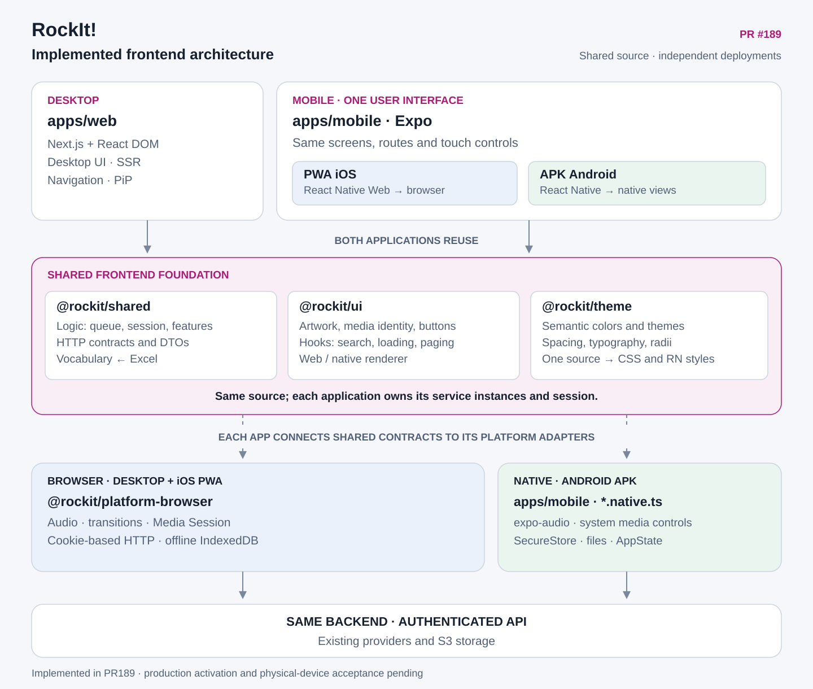
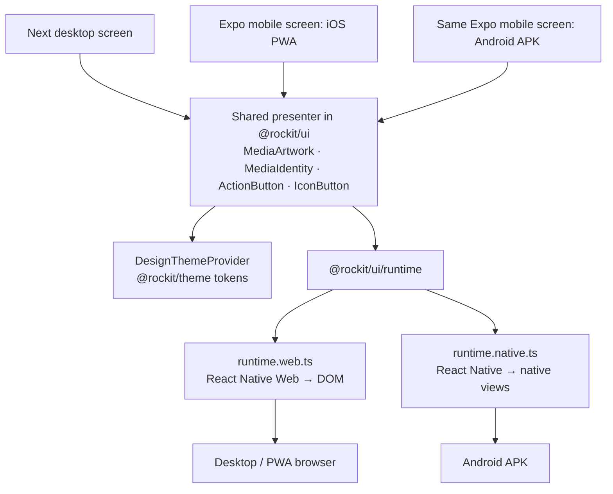

# Implemented frontend architecture

This guide maps the frontend applications to their shared packages and platform
adapters. Use [verification](FRONTEND_TESTING.md) for test coverage and
[deployment](FRONTEND_DEPLOYMENT.md) for rollout and installed-device acceptance.



[Spanish overview diagram](../diagrams/frontend-implementation.es.svg).

## Applications and shared source

There are two application entry points. `apps/web` is the Next desktop application.
`apps/mobile` is the Expo application, whose screens run through React Native Web
for the iOS Home Screen PWA and through React Native for the Android APK. The mobile
PWA has its own static deployment output; it is not a mobile tree hidden inside Next.

Both applications consume shared source packages. This does not give them one live
player, store, cookie or session: each application composes and owns its own running
service instances. HTTP/WebSocket communication still goes through the existing
backend. The shared frontend package is unrelated to the backend's `core` module.

| Responsibility                                                                                                       | Source                                                                            | Reuse                                                        |
| -------------------------------------------------------------------------------------------------------------------- | --------------------------------------------------------------------------------- | ------------------------------------------------------------ |
| Portable domain logic, queue/user bases, social/radio/notification policies, generated HTTP contracts and vocabulary | [`packages/shared`](../../packages/shared/src/index.ts)                              | Desktop, PWA and Android                                     |
| Universal UI primitives and renderer-independent React hooks                                                         | [`packages/ui`](../../packages/ui/src/index.ts)                                      | Desktop and mobile where the presentation is suitable        |
| Semantic colors, themes, spacing, radii, typography, motion and layout scales                                        | [`packages/theme`](../../packages/theme/src/tokens.json)                             | One token source for desktop CSS and universal/native styles |
| Browser audio/transitions, Media Session, HTTP and offline storage                                                   | [`packages/platform-browser`](../../packages/platform-browser/package.json)          | Desktop and mobile PWA                                       |
| Mobile screens, navigation, touch interactions and safe areas                                                        | [`apps/mobile/components`](../../apps/mobile/components)                             | PWA and native Android                                       |
| Native player, secure session, files, lifecycle and Android system integrations                                      | [`apps/mobile/lib`](../../apps/mobile/lib) and [`platform`](../../apps/mobile/platform) | Native target only, selected through platform entries        |
| Desktop layouts, server rendering and PiP                                                                            | [`apps/web`](../../apps/web)                                                         | Desktop only                                                 |

Vocabulary comes from [`Vocabulary.xlsx`](../../Vocabulary.xlsx), with generated shared
types/fallbacks and the existing vocabulary service. Shared colors come from tokens;
a component does not maintain a second palette for each application.

## How a component is actually shared

The same presenter imports a small runtime contract. The renderer entry resolves to
React Native Web in the browser and React Native in the APK. This selection happens
at build/module resolution, rather than mounting both presentations and hiding one.



These are real source examples:

- [`MediaArtwork`](../../packages/ui/src/primitives/MediaArtwork.tsx) is consumed by
  desktop [`LibraryRows`](../../apps/web/components/Library/LibraryRows.tsx).
- [`MediaIdentity`](../../packages/ui/src/primitives/MediaIdentity.tsx),
  [`ActionButton`](../../packages/ui/src/primitives/ActionButton.tsx) and
  [`IconButton`](../../packages/ui/src/primitives/IconButton.tsx) are used by mobile
  screens such as the [`notification inbox`](../../apps/mobile/components/Notifications/NotificationButton.tsx)
  and [`sharing composer`](../../apps/mobile/components/Friends/ShareMediaComposer.tsx).
- [`runtime.web.ts`](../../packages/ui/src/runtime.web.ts) and
  [`runtime.native.ts`](../../packages/ui/src/runtime.native.ts) implement the same
  primitive contract. [`package exports`](../../packages/ui/package.json) and the
  application resolvers select the implementation.
- [`DesignThemeProvider`](../../packages/ui/src/theme.tsx) supplies semantic values.
  [`ThemeProvider` in Next](../../apps/web/components/providers/ThemeProvider.tsx)
  and the mobile application resolve the user's theme independently.

Sharing a primitive does not make the whole desktop and mobile screen identical.
Desktop DOM menus, PiP and SSR stay in the desktop application. Mobile navigation,
action sheets and full-screen player stay in the mobile application. Headless hooks
share behavior even when the surrounding layout needs a different presentation.

## A real shared feature: Library song search

Both application wrappers call the same
[`usePagedSearch`](../../packages/ui/src/headless/usePagedSearch.ts). That hook owns
query debouncing, pagination and stale-request/account protection; each wrapper
supplies its typed HTTP request and account scope. It is consumed by the
[desktop search hook](../../apps/web/components/Library/hooks/useLibrarySongSearch.ts)
and the [mobile search hook](../../apps/mobile/hooks/useLibrarySongSearch.ts).

```mermaid
sequenceDiagram
    actor User
    participant View as Desktop or mobile Library
    participant Search as Shared usePagedSearch
    participant HTTP as Application HTTP adapter
    participant API as Existing backend
    participant Queue as Application queue/player
    User->>View: Search for a song
    View->>Search: Query, account scope, sort
    Search->>Search: Debounce; reject obsolete work
    Search->>HTTP: Request one bounded page
    HTTP->>API: Authenticated Library song search
    API-->>HTTP: Songs from Library albums/playlists
    HTTP-->>Search: Validated success or explicit error
    Search-->>View: Songs, loading/error state, pagination
    User->>View: Play one result
    View->>Queue: Play selected song alone
```

The result view can show album artwork and the individual song title. Selecting a
song does not enqueue its entire containing album. The browser acceptance fixture
also covers a song which exists only inside a Library playlist.

## Platform APIs stay outside portable logic

The PWA and desktop reuse the browser player; the Android APK uses the native
player. Common policy calls typed services; the applications inject the platform
implementation. Portable domain code does not import Next, Expo or native modules.

| Capability     | Desktop and PWA                                                                                                                | Native Android                                                                                                        |
| -------------- | ------------------------------------------------------------------------------------------------------------------------------ | --------------------------------------------------------------------------------------------------------------------- |
| Playback       | Shared [browser player](../../packages/platform-browser/src/managers/mediaPlayerManager.ts), HTML media and browser Media Session | [Native player](../../apps/mobile/lib/managers/mediaPlayerManager.native.ts), expo-audio/video and native media controls |
| Authentication | Browser cookies and browser HTTP transport                                                                                     | [Native session adapter](../../apps/mobile/lib/api.native.ts), SecureStore and guarded cookie updates                    |
| Offline media  | [Shared browser storage](../../packages/platform-browser/src/offline/store.ts), IndexedDB                                         | [Native media storage](../../apps/mobile/lib/storage/mediaStorage.native.ts), existing native file locations             |
| Lifecycle      | Browser visibility/resume adapter                                                                                              | [Native resume adapter](../../apps/mobile/platform/resume.native.ts), AppState                                           |
| Shell loading  | Independent Next desktop build or static mobile PWA output                                                                     | Native APK bundle                                                                                                     |

The PWA also has a public-shell service worker. It does not cache authenticated API
responses or signed media URLs. Account-scoped metadata caching is a separate policy.
Native storage and iOS browser storage have different retention and capability limits;
sharing code does not make those guarantees equal.

The existing native player is single-deck. The browser transition implementation is
reused by the PWA. This migration does not imply native Android crossfade parity.
Likewise, the shared notification inbox is not a claim that a new push-notification
or local scheduling service has been installed.

## Where to extend the application

- A portable policy or API contract belongs in `packages/shared`.
- A reusable renderer-independent hook or universal presenter belongs in `packages/ui`.
- A shared design value belongs in `packages/theme`; translated UI text belongs in
  `Vocabulary.xlsx` and its generated vocabulary.
- A mobile-specific layout belongs in `apps/mobile/components`; iOS PWA and Android
  consume it together. Use a platform entry only when the behavior actually differs.
- A browser integration belongs in `packages/platform-browser` when both browser
  applications use it; desktop-only PiP stays in `apps/web`.
- A native integration belongs in the mobile platform adapter, not in portable logic.

[Migration progress](../archive/FRONTEND_MIGRATION_PROGRESS.md) records the implementation and
open device gates. The [original architecture research](../archive/FRONTEND_PLATFORM_ARCHITECTURE.md)
explains the alternatives and platform limitations behind these choices.
