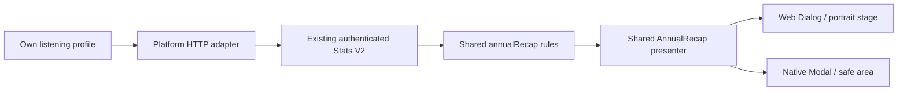

# Annual recap

RockIt!'s recap turns the authenticated account's recorded year into a short
story sequence. Web and mobile use the same presenter and calculation rules.
There is one on-demand request to the existing `/stats/v2/user` endpoint; no new
backend endpoint, external API, model service, scheduled job or database table is
introduced.

## Research and scope

Reviewed official sources, November 2026:

- [Spotify's 2025 methodology](https://newsroom.spotify.com/2025-12-05/wrapped-methodology-explained/):
  song rankings use qualifying listen counts, while artist rankings weight primary
  and secondary credits differently. Album rankings have another method. These
  are documented choices, rather than a universal recap standard; exact weighting
  and every eligibility rule are not published.
- [Spotify Engineering's account of Wrapped Archive](https://engineering.atspotify.com/2026/3/inside-the-archive-2025-wrapped):
  priority-ordered heuristics identify notable listening days. Some narratives
  then use generated text grounded in those selected facts. Our small deployment
  needs neither that infrastructure nor generated prose.
- [YouTube's 2024 Music Recap overview](https://blog.youtube/news-and-events/2024-music-recap-youtube/):
  top music, timeline cards, listening descriptions and character stories are
  public features. The article does not disclose a complete character classifier.
- [YouTube Music eligibility](https://support.google.com/youtubemusic/answer/11418178?hl=en):
  recap depends on retained listening history and its own eligibility windows.
  Those service-specific thresholds are not copied into RockIt!.

| Story                | RockIt! evidence/rule                                                           |
| -------------------- | ------------------------------------------------------------------------------- |
| Time and activity    | Recorded interval duration, distinct recordings and active days from Stats V2   |
| Number-one recording | Existing song ranking by recorded listening milliseconds                        |
| Top recordings       | Up to five positive-duration entries                                            |
| Artist countdown     | Up to five existing artist-ranking entries, revealed from last to first         |
| Kept the rhythm      | Longest in-range streak is at least 14 days                                     |
| Discovery narrative  | Otherwise, at least 20 first-time recordings in the existing discovery metric   |
| Your own pace        | Otherwise, a neutral statement about the recorded active-day count              |
| Loudest chapter      | Highest positive monthly bucket; day/week buckets are never presented as months |
| Closing card         | The same minutes and artist data already shown                                  |

These are our own deterministic editorial rules. Rankings intentionally reuse
RockIt!'s listening-time metric, rather than claiming to reproduce Spotify's
stream weighting. Collaborations may credit several artists. We do not have the
catalog classification or population data needed to substantiate musical-age,
mood, genre-affinity or worldwide-fan-percentile claims. Sparse accounts get
shorter stories; an account with no interval history gets an explicit empty state.

## Calendar and coverage

A recap starts on January 1 in UTC and ends exclusively at the earlier of now or
the following January 1. A current-year recap says “year so far”; completed years
include the full calendar year, including leap day. The displayed final date is
the inclusive date corresponding to that exclusive cutoff. Times follow the
existing Stats V2 recording semantics and the period is labeled UTC.

The profile entry opens the current year, with the previous year available on the
intro/empty screen. Only the current account can open this experience. It uses
the platform HTTP adapter and existing validated DTOs. Listening absent from the
server history, including offline activity not delivered to the server, cannot
be inferred or reconstructed by the recap.

## Shared implementation

`packages/shared` owns range calculation, narrative selection and story data.
`packages/ui` owns the presenter, progress clock and navigation. Hosts provide
logo assets, locale, the configured HTTP adapter and dismissal; web adds arrow-key
and Space controls through a listener limited to the open experience. Host
Dialog/Modal ownership, account-scope keys and resource generations preserve
focus and prevent stale data publishing after a profile/account change.

Auto-advance starts after the introduction and stops on the closing card. Pause,
holding a card and app backgrounding suspend progress. Reduced-motion preference
uses manual navigation. The timer runs only inside the narrow progress strip;
artwork and narrative content do not rerender on every tick. Music playback is
never started, paused or replaced by this experience. Layout, colors, timing and
copy come from shared tokens and Vocabulary.xlsx in English, Spanish and French.

## Verification

Portable tests cover calendar/leap-year boundaries, sparse/empty data, countdown
order, narrative thresholds, monthly-bucket safeguards, HTTP failure propagation,
pause/background behavior and reduced motion. Native controls and browser flows
cover the presenter and both profile hosts. Browser captures use synthetic fixture
listening history. Real iPhone background transitions and APK acceptance remain
physical-device checks; no new PostgreSQL query or migration needs validation.

The initial acceptance run passed eight portable/DOM tests, one native control
test and three Chromium host flows. Both production builds, application lint,
frontend/test types and generated theme checks passed. Browser flows cover
320×667 and 390×844 mobile layouts, the desktop portrait stage, keyboard/focus
restoration, selecting the completed previous year and a failed read with retry.
